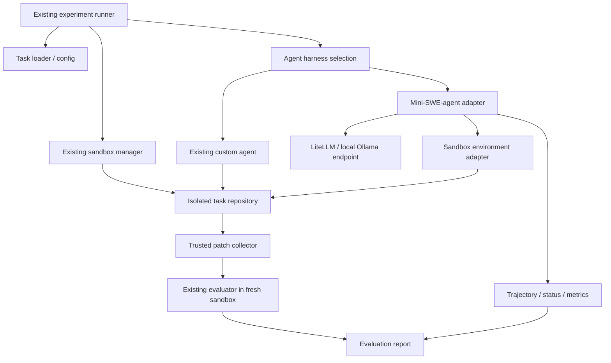

# Mini-SWE-agent Integration Plan

> Project: `deepswe-experiment`  
> Base branch: `local-model`  
> Proposed branch: `feature/mini-swe-agent`  
> Status: Proposed — implementation not started  
> Date: 2026-11-21

## 1. Background and objectives

Dự án hiện có custom coding agent tự quản lý agent loop, inference calls, tool execution trong sandbox và sinh patch. Khi chạy trên research server, agent gặp nhiều lỗi, khiến việc thực hiện benchmark và phân tích kết quả khó ổn định.

Mục tiêu là tích hợp **mini-SWE-agent như một agent harness thay thế**, sử dụng local LLM qua Ollama, giữ nguyên các thành phần benchmark, sandbox và evaluation đang hoạt động. Không viết lại toàn bộ hệ thống và không thay đổi định nghĩa benchmark chỉ để thích ứng với harness mới.

DeepSWE sử dụng mini-SWE-agent làm harness chung trong thiết lập thực nghiệm của paper gốc [1]. Việc áp dụng cùng loại harness có lợi cho việc chuẩn hóa so sánh giữa các model; tuy nhiên, chỉ có thể tuyên bố tái lập thiết lập gốc sau khi kiểm chứng version, prompt, budget, runtime và verifier tương ứng.

### Definition of done

- [ ] Có thể chọn `custom` hoặc `mini-swe-agent` từ configuration/CLI của runner.
- [ ] Mini-SWE-agent chạy tự động với local model, không cần tương tác người dùng.
- [ ] Mọi Bash command do agent sinh ra chạy đúng trong sandbox của task.
- [ ] Thu được unified Git diff từ đúng base revision, bao gồm file mới, file đã commit, sửa và xóa file.
- [ ] Patch được verifier hiện tại tiếp nhận và đánh giá trong môi trường sạch, độc lập.
- [ ] Mỗi attempt lưu trajectory, metadata, exit status và lỗi (nếu có).
- [ ] Timeout/retry/cleanup không làm mất kết quả hoặc ảnh hưởng task khác.
- [ ] Hoàn thành smoke test và pilot trước khi chạy toàn bộ benchmark.

## 2. Scope and assumptions

### In scope

- Tích hợp mini-SWE-agent qua Python API và một adapter mỏng.
- Kết nối Ollama đang dùng trên server; giữ interface mở cho vLLM sau này.
- Reuse sandbox lifecycle, task loader, runner, patch/evaluation pipeline nếu tương thích.
- Thêm configuration, trajectory logging, failure classification và integration tests.
- Đảm bảo có thể rollback về custom agent.

### Out of scope

- Thay đổi dataset, verifier, research questions hoặc evaluation metrics hiện tại.
- Viết lại agent loop của mini-SWE-agent, thêm planning/memory/RAG/subagents.
- Chuyển sang OpenHands, OpenCode hoặc đổi inference backend trong cùng migration.
- Full benchmark trước khi các acceptance gates được đáp ứng.

**Repository access limitation:** tại thời điểm lập plan, chưa đọc được source branch [`local-model`](https://github.com/Bonkaaa/deepswe-experiment/tree/local-model). Do đó mọi tên file, CLI flags, interfaces của project ở dưới là đề xuất, không phải mô tả source đã xác minh. Bước đầu tiên phải audit repo local và adapt theo code thực tế. Không tạo kiến trúc song song nếu project đã có abstraction tương đương.

## 3. Architecture decision

### Target architecture



### Responsibility boundaries

| Component | Owner | Responsibility |
|---|---|---|
| Experiment orchestration | Existing project | Load tasks, select model/harness, schedule attempts, set budgets |
| Sandbox lifecycle | Existing project | Create, initialize, execute, stop and remove sandbox |
| Agent loop | mini-SWE-agent | Prompt, inference calls, parse actions, observations, termination |
| Model inference | Ollama | Serve model on host or approved inference node |
| Environment adapter | Integration code | Forward actions into existing sandbox; no host-shell fallback |
| Patch collection | Trusted runner | Capture Git changes against known base; validate and persist patch |
| Evaluation | Existing verifier | Apply patch in fresh environment and calculate existing metrics |

**Preferred approach:** run mini-SWE-agent controller outside the task sandbox; only agent-generated Bash actions run inside it. The controller can access the local inference endpoint without exposing the host, credentials or model server to the agent's shell.

**Fallback approach:** if the current sandbox only supports running a complete program inside it, run the pinned harness inside that isolated runtime, with explicit network access only to the inference endpoint and a verified artifact collection mechanism. Do not nest Docker or mount the Docker socket into a task container.

The upstream native Docker/Apptainer environment is an alternative if reusing the existing sandbox is demonstrably infeasible [3]. Only one component should own each sandbox lifecycle.

## 4. Phase 0 — Audit current implementation (P0)

Create the feature branch from the intended local-model revision. Do not overwrite uncommitted work.

```bash
git status --short
git branch --show-current
git rev-parse HEAD
# After confirming the working tree and base branch:
git switch local-model
git switch -c feature/mini-swe-agent
```

Locate integration points:

```bash
git ls-files
rg -n 'ollama|litellm|agent_loop|sandbox|model_patch|git diff|verifier|timeout' \
  --glob '*.py' --glob '*.toml' --glob '*.yaml' --glob '*.yml'
```

- [ ] Identify current agent entry point and how runner calls it.
- [ ] Identify sandbox backend (Docker, remote API, Harbor/Pier, or other), command execution signature, working directory, environment variables and file transfer mechanism.
- [ ] Identify model endpoint, request protocol, model names and current generation settings.
- [ ] Identify task id, task prompt, base commit, sandbox image and verifier metadata.
- [ ] Identify how patches are currently collected and passed to evaluator; check if it expects raw diff, JSON/JSONL or committed changes.
- [ ] Inspect dependency manager, Python version, logging format, existing tests and retry policy.
- [ ] Save an existing representative failure log and a known working evaluator fixture (no gold patch exposed to agent).
- [ ] On shared server, check available disk, GPU and authorized sandbox permissions (`df -h`, `nvidia-smi`, backend status). Do not prune shared images or other users' data.

**Deliverable:** an integration map (`actual file/function -> proposed change`) and one known reproducible task. Record the current project, dataset and sandbox revision. If the evaluator cannot grade a known valid fixture, fix that independently before blaming harness integration.

## 5. Phase 1 — Pin harness and prove local inference (P0)

Current upstream documentation is for mini-SWE-agent v2, which has API changes from v1 [2, 4]. Do not mix v1 code samples with a v2 dependency.

### Version policy

1. Check DeepSWE paper §5.2 and official benchmark/Pier release metadata for the actual harness revision used in the desired experiment.
2. Prefer that revision if reproducibility against the original setup is required and the environment supports it. Otherwise select a stable tested v2 release/commit, explicitly document the difference, and use that single version for all experimental runs.
3. Pin the commit/version, Python and transitive dependencies (including LiteLLM) in the project's existing lockfile or a dedicated runner environment. Do not install an unpinned `main` on the server.
4. Inspect the installed `Agent.run`, environment protocol, model factory, submission logic and trajectory writer. Add a contract test for the selected version.

An isolated proof-of-concept environment, if needed (replace the placeholder with a verified release and use the project's dependency manager for production):

```bash
python -m venv .venv-mini-smoke
source .venv-mini-smoke/bin/activate
python -m pip install 'mini-swe-agent==<VERIFIED_VERSION>'
python -m pip check
python -m pip show mini-swe-agent litellm
```

### Ollama preflight

Run from the intended controller environment, not the task's shell:

```bash
export OLLAMA_BASE_URL=http://127.0.0.1:11434
curl --fail --silent --show-error "$OLLAMA_BASE_URL/api/version"
curl --fail --silent --show-error "$OLLAMA_BASE_URL/api/tags"
```

Use the existing Ollama service/model; confirm the port and access with admin if the node is shared. `127.0.0.1` is valid only if the inference service is on the same network namespace as the controller. Do not expose an unauthenticated Ollama endpoint publicly or start/stop another user's service.

Proposed **v2 configuration fragment**, to validate against the pinned model class; merge into the upstream benchmark/default config, rather than substituting this fragment for the complete prompt templates:

```yaml
model:
  model_name: "ollama_chat/<EXACT_MODEL_TAG>"
  model_kwargs:
    api_base: "http://127.0.0.1:11434"
    temperature: 0.0
  cost_tracking: "ignore_errors"
```

The example prefix must be confirmed with the pinned LiteLLM version. For v2, explicitly choose the model class: prefer the upstream text-based Bash parser (`litellm_textbased`) if matching the Bash-only benchmark setup or if the model does not reliably support native tool calls [4]. Verify the matching prompt/action format; do not silently switch parsers between models. Local API price metadata may be missing; record unknown cost/token data as unknown, not zero. Actual GPU inference cost is not necessarily zero.

- [ ] Test one model call through the harness's actual model adapter.
- [ ] Test a valid Bash action and one malformed action using the selected parser.
- [ ] Confirm model runs with explicit effective context length and output limit; check that input is not silently truncated.
- [ ] Record model tag/digest, quantization, Ollama version, sampling settings, GPU memory use and tokens/sec where available.
- [ ] Use a disposable sandbox/repository to create a small file, run a check and submit.

**Acceptance gate G1:** local inference, tool parsing, sandbox execution and termination work in one standalone attempt, without cloud fallback or user input. A failure must identify which layer caused it.

## 6. Phase 2 — Implement harness adapter (P0)

Suggested layout (adapt to existing package structure):

```text
<existing project package>/
  agents/
    base.py                       # reuse/add common interface
    custom_agent.py               # preserve existing implementation
    mini_swe_agent.py             # new thin harness adapter
  environments/
    mini_swe_environment.py       # forwards calls into existing sandbox
  configs/
    mini_swe_agent.yaml            # pinned upstream config + explicit overrides
  tests/
    test_mini_swe_agent.py
    test_mini_swe_environment.py
    test_patch_collection.py
    test_mini_swe_integration.py
```

### 6.1 Common contract

Keep existing result interfaces if already suitable. Illustrative Python contract, not ready-to-run repo code:

```python
from dataclasses import dataclass
from pathlib import Path
from typing import Protocol


@dataclass
class AgentResult:
    instance_id: str
    attempt_id: str
    harness: str
    exit_status: str
    patch: str | None
    trajectory_path: Path | None
    duration_seconds: float
    num_steps: int | None = None
    input_tokens: int | None = None
    output_tokens: int | None = None
    error_type: str | None = None


class AgentHarness(Protocol):
    def run(self, *, task, sandbox, config, output_dir: Path) -> AgentResult: ...
```

Use the project's actual Task, Sandbox and Config types. `patch=None` means extraction unavailable; `patch=""` means valid extraction found no changes. Keep those distinct. `exit_status` is a harness outcome, not a verifier success boolean.

### 6.2 Sandbox environment adapter

For the v2 API, the environment executes an action dictionary and accepts a working directory; v1 has a different contract [4]. Example skeleton illustrating only v2's method shape:

```python
class MiniSweSandboxEnvironment:
    def __init__(self, sandbox, repo_dir):
        self.sandbox = sandbox
        self.repo_dir = repo_dir

    def execute(self, action: dict, cwd: str = "") -> dict:
        # Forward action["command"] to the existing isolated executor.
        # Normalize stdout/stderr, return code, timeout and other fields
        # to the exact contract required by the pinned environment API.
        raise NotImplementedError

    def get_template_vars(self, **kwargs) -> dict:
        raise NotImplementedError

    def serialize(self) -> dict:
        # Non-secret environment metadata only.
        raise NotImplementedError
```

Implementation requirements:

- Every command must run inside the task sandbox, with its repository as the default working directory. `cwd` must refer to the sandbox, never host paths. Preserve the approved task environment and shell semantics.
- Match upstream output field types and timeout semantics. Preserve non-zero command exit codes as observations rather than treating all as infrastructure exceptions.
- Each action can start a new Bash invocation; do not assume `cd` or shell variables persist between commands. Filesystem changes must persist throughout the attempt.
- Enforce command timeouts, output limits, memory/CPU/disk limits and network policy. Ensure cancellation kills remaining processes before collecting changes.
- Do not mount host home, secrets, unrelated repositories, evaluator assets, docker socket or privileged devices. No network by default for the agent shell, except explicitly required benchmark policy. The controller alone accesses Ollama.
- Adapter only forwards commands; do not reimplement prompt parsing, retry loop, tool dispatch or termination logic from mini-SWE-agent.

### 6.3 Agent adapter orchestration

1. Receive already-initialized sandbox and task from runner.
2. Create a fresh model, environment adapter and upstream `DefaultAgent` for this attempt.
3. Provide pinned upstream prompt templates, task text and budget settings; invoke `agent.run(task_prompt)` once.
4. Save native trajectory and raw exit status, including on exceptional exit where possible. v2 supports `agent.save(path)` and returns a dictionary, unlike v1 [4, 5]. For hard kills, persist outer logs and mark trajectory as partial/unavailable; implement checkpointing only if necessary and supported without modifying the loop.
5. Freeze agent execution, collect Git patch through the trusted runner, validate/export it and normalize result.
6. Runner owns cleanup in `finally` after artifact capture; evaluation can proceed independently from the generation sandbox.

No silent fallback to the custom agent on failure. A fallback would change the experimental treatment.

### 6.4 Runner and configuration

Proposed project-level config (not an upstream mini-SWE-agent YAML schema):

```yaml
agent:
  harness: mini-swe-agent           # custom | mini-swe-agent
  upstream_config: configs/mini_swe_agent.yaml
model:
  provider: ollama
  name: <EXACT_MODEL_TAG>
  api_base: http://127.0.0.1:11434
budget:
  max_steps: 100
  command_timeout_seconds: 120
  model_timeout_seconds: 180
  task_timeout_seconds: 1800
runtime:
  workers: 1
  max_infrastructure_retries: 1
```

These are illustrative pilot values, not the official DeepSWE settings. Map them to fields supported by the pinned harness and current runner. Define whether each budget counts model calls or shell actions. Do not promise deterministic GPU output from temperature 0 alone. Expose a harness selector using existing CLI conventions. Keep the existing default (`custom`) until pilot acceptance, then explicitly switch experiment configurations.

**Acceptance gate G2:** runner can invoke either harness using the same task/sandbox/evaluator contracts; mock and real environment tests demonstrate no host-shell escape or interactive prompts.

## 7. Phase 3 — Patch collection and evaluation (P0)

### 7.1 Source of truth

Prefer the current trusted patch collector if it satisfies the requirements below. Do not rely on a diff written as free text by the LLM. Persist upstream submission separately for diagnostics and compare it with the workspace state if appropriate.

At task initialization, verify repository root, expected commit and clean status. Record the base hash outside the agent's mutable workspace. After the agent stops and before sandbox cleanup, capture changes against that hash. Example commands to execute by the trusted runner **inside the task repository**, never the experiment repo on host:

```bash
# At initialization (trusted runner):
git rev-parse HEAD
git status --porcelain=v1
# Assert the expected base commit and clean baseline here.

# At collection, BASE_COMMIT comes from trusted runner metadata:
git cat-file -e "${BASE_COMMIT}^{commit}"
git add -A -- .
git --no-pager diff --cached --binary --full-index --no-ext-diff \
    --no-textconv --no-color "$BASE_COMMIT" -- .
```

Capture stdout as `patch.diff` outside the worktree (or through sandbox file export). Check return codes and byte integrity; command outputs must not be truncated. This includes staged/unstaged changes plus non-ignored untracked files and changes committed after base. Do not silently drop binary or ignored files: enforce a documented benchmark policy, report unsupported changes, and avoid staging generated dependencies/caches by accident. Test submodules separately if tasks contain them. Preserve repository paths, file modes and newline markers. Set reasonable artifact limits and classify over-limit patches explicitly.

Some DeepSWE releases, including current upstream v1.1+, use a collector that extracts committed work and applies the resulting patch to a pristine verifier environment [6]. If the project's pinned task format requires commits, implement the official submission contract through the trusted integration layer; do not assume raw working-tree edits are sufficient. Do not replace existing verified collection behavior without a parity test.

### 7.2 Validate and evaluate

- [ ] Verify the patch is applicable to a fresh workspace at the exact baseline (`git apply --check --binary patch.diff`, or the equivalent official verifier check). Use a separate workspace, not the edited agent workspace.
- [ ] Export raw patch and existing evaluator format; if SWE-bench-style predictions are needed, map `instance_id`, `model_name_or_path`, `model_patch` as documented [5]. Keep repeated attempts separate.
- [ ] Run existing verifier only, preserving its normal output format/metrics and timeout.
- [ ] Keep hidden tests, reference solutions, previous result artifacts and verifier secrets inaccessible to agent sandboxes, including Git history and network routes. Inspect the task packaging for leakage before pilot.
- [ ] Apply exactly the saved patch bytes, not a later snapshot or a manually repaired diff.
- [ ] Keep patch validity, harness outcome and test outcome as independent fields. For timeouts/failed submission, save recoverable partial diff separately; grade it only if predefined evaluator policy allows it. Never silently promote it to a successful submission.

**Acceptance gate G3:** fixture tests cover modify, add, delete, rename/mode, binary (if allowed), staged+unstaged changes, agent-created commits and empty patches. A known-valid fixture yields the same verifier result before and after integration. Invalid patch is explicitly reported.

## 8. Phase 4 — Observability, error handling and reliability (P0)

### Output structure

Reuse existing naming if possible. Keep separate directory per run/task/attempt to prevent overwrites:

```text
outputs/<run_id>/<instance_id>/<attempt_id>/
  config.resolved.yaml       # secrets removed
  metadata.json
  agent.traj.json            # upstream format, if available
  agent.log
  patch.diff                 # finalized submission, if available
  partial.diff               # optional diagnostic artifact
  result.json
  verifier/                  # existing evaluation output
```

Metadata minimum: project commit, harness version/commit, model tag and digest, inference backend version, prompt/template hash, dataset revision, task ID, base commit, image digest, budgets, sampling/context settings, repeat index and timestamps. Include raw harness status, normalized failure type, token usage if reported, action/model call counts, runtime and patch hash. Exclude API keys and other secrets from config/logs; restrict permissions for trajectories.

### Failure taxonomy

| Failure | Classification | Retry policy |
|---|---|---|
| Sandbox cannot start / backend unavailable | Infrastructure | Bounded, fresh sandbox |
| Transient inference transport error | Infrastructure | Bounded, record all attempts |
| Model not found / invalid config | Configuration | Fail fast |
| GPU OOM / capacity contention | Resource/infrastructure | Diagnose; no silent budget/model change |
| Malformed model action | Agent/model | Use pinned harness's normal recovery; no external retry solely to improve score |
| Test command exits nonzero | Normal observation | Continue per agent policy |
| Context overflow / task wall-time / step limit | Budget/model failure | Do not automatically retry as infrastructure |
| Empty or non-applicable patch | Submission outcome | Preserve; no selective rerun |
| Verifier service/setup failure | Evaluation infrastructure | Retry evaluation with identical patch only |
| Verifier reports failing tests | Task failure | No automatic regeneration |

Record every retry and distinguish scientific attempts from infrastructure retries. Avoid duplicate retry layers (LiteLLM, harness, runner). Define scoring/exclusions in advance. DeepSWE §5.6 offers a reference policy [1]; use the project's existing policy when applicable and report deviations. Count true agent failures in reported task metrics; do not silently discard them. Report infrastructure failure rate separately with explicit denominator.

- [ ] Enforce outer wall-clock timeout independently of per-command and inference timeout.
- [ ] Kill only task-owned processes/containers; cleanup must be idempotent and scoped by run ID.
- [ ] Write final metadata/results atomically; recover or mark interrupted attempts.
- [ ] Bound logs and artifact size; check free space, avoid duplicating model weights across task sandboxes.
- [ ] Test resume: skip already finalized attempts, avoid duplicate results and resume verifier without rerunning agent when patch exists.

**Acceptance gate G4:** injected executor errors, model disconnect, timeout and patch export failure produce distinguishable results; no orphan task sandbox or unbounded retry; artifacts remain available after cleanup.

## 9. Phase 5 — Pilot and experimental validation (P1)

| Stage | Setup | Expected outcome |
|---|---|---|
| Smoke | 1 disposable repository, 1 local model | Read/edit/test/submit works completely |
| End-to-end | 1 actual DeepSWE task | Patch exports and authentic verifier runs |
| Regression | 3–5 representative tasks, workers=1 | No integration regressions, artifacts intact |
| Paired pilot | 10–20 fixed tasks × custom/mini × same local model | Compare reliability, patch validity, wall time and success |
| Concurrency | Increase workers from 1 to 2, then higher only if measured safe | No GPU OOM, cross-task contamination or disk exhaustion |
| Freeze | Pin accepted code/config/revisions and task list | Ready for full experiment |

Select pilot tasks by fixed IDs/seed, covering multiple languages or task characteristics and known historical failure categories. Use fresh sandboxes for each attempt, same dataset/base/image, same task content, same model revision, temperature/context/output settings and comparable resource budgets. Keep harness-native prompts as part of the harness treatment for the paired comparison; document any project-specific modifications. For model comparison after migration, hold harness, prompt templates and evaluation conditions fixed across models.

### Metrics

- Infrastructure failure rate = infrastructure-failed attempts / all started attempts (report initial attempts and post-retry outcomes separately).
- Patch extraction and applicability rate (show denominator and empty patches separately).
- Verifier completion rate and task success/pass rate using predefined scoring rules.
- Wall time, model calls, Bash actions, input/output tokens and resource usage where measurable. Report missing measurements explicitly.
- Failure distribution and representative trajectories for debugging/qualitative analysis.

### Proposed pilot acceptance thresholds (engineering gates, not research findings)

- [ ] All started attempts have a terminal result or explicit interruption record.
- [ ] All available non-empty submitted patches have an applicability verdict and evaluator outcome (or explicit verifier infrastructure error).
- [ ] Zero observed host-shell fallback, cross-task leakage, orphan sandboxes or overwritten results.
- [ ] No unresolved reproducible adapter/collector defects; infrastructure failure rate reported and investigated (target at most 5% after bounded retry, interpreted cautiously on small samples).
- [ ] Completed paired results retained even when mini-SWE-agent has lower task success. Do not tune/exclude tasks merely to obtain a better score.
- [ ] Document GPU throughput and sustainable concurrency before full-scale launch.

If gates fail, fix integration, rerun smoke and regression fixtures, then rerun a versioned pilot. Preserve prior results. After acceptance, freeze the experimental setup; later changes require a new run/config version.

## 10. Implementation order and review checklist

| PR / milestone | Work | Depends on |
|---|---|---|
| PR 1 | Repo audit, version pin, local model smoke test | — |
| PR 2 | Harness selector + environment adapter + contract tests | PR 1 |
| PR 3 | Mini agent adapter + patch/result compatibility + real task integration | PR 2 |
| PR 4 | Timeout, retries, trajectory, failure taxonomy, resume and cleanup | PR 3 |
| PR 5 | Paired pilot report, reproducibility manifest, docs and selected default | PR 4 |

- [ ] Avoid unrelated refactors or changing benchmark semantics.
- [ ] Do not modify upstream harness source unless necessary; if modified, store and version the diff and disclose it in the experiment setup.
- [ ] Keep custom agent callable and test that it still works.
- [ ] Check that the only new trust boundary is the approved controller-to-sandbox executor API; no task may access the controller filesystem or credentials.
- [ ] Add README commands for setup, single run, pilot, resume, cleanup and switching harness. Use the actual project CLI after audit.

### First implementation session

**Only implement the smallest vertical slice first:** audit the current runner and sandbox -> pin mini-SWE-agent -> call Ollama from controller -> execute one Bash action in a disposable sandbox -> generate a file -> extract diff -> persist trajectory -> evaluate one real task. Do not start by rewriting the framework, introducing multiple harnesses or launching full batch runs.

### Rollback

The old agent remains selectable via existing CLI/config (`harness: custom`, proposed). Revert the new feature flag/default configuration or the integration PRs if necessary; leave prior experimental artifacts untouched. Never mix results from different harnesses under the same run identity.

## 11. References

1. Huang et al. (2026), *DeepSWE: Measuring Frontier Coding Agents on Original, Long-Horizon Engineering Tasks*, §5.2 (harness), §5.6 (failure scoring): https://arxiv.org/html/2607.07946
2. mini-SWE-agent official repository and Python bindings: https://github.com/SWE-agent/mini-swe-agent ; https://mini-swe-agent.com/latest/usage/python_bindings/
3. Execution environment classes: https://mini-swe-agent.com/latest/advanced/environments/
4. v2 migration guide (model classes, environment protocol, return types): https://mini-swe-agent.com/latest/advanced/v2_migration/
5. Trajectory and predictions formats: https://mini-swe-agent.com/latest/usage/output_files/
6. Official DeepSWE benchmark repository, task format and verifier isolation: https://github.com/datacurve-ai/deep-swe
7. Local model configuration, cost tracking and vLLM examples: https://mini-swe-agent.com/latest/models/local_models/
8. Upstream extension cookbook: https://mini-swe-agent.com/latest/advanced/cookbook/

Consult the matching documentation for the version ultimately pinned. Upstream links marked `latest` may change; record commit-specific links in the final experiment manifest.
