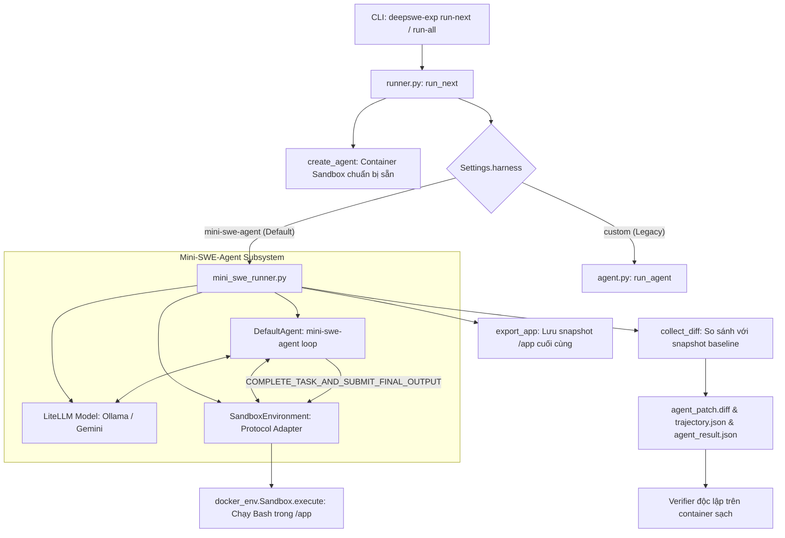

# Kế hoạch Triển khai (Bản hoàn thiện): Tích hợp `mini-SWE-agent` làm Execution Harness cho DeepSWE Experiment

> **Dự án:** `deepswe-experiment`  
> **Nhánh thực thi:** `mini-swe-agent` (tách từ `local-model`)  
> **Trạng thái:** Đã phê duyệt qua phỏng vấn kiến trúc `/grill-me` — Sẵn sàng triển khai  
> **Ngày lập:** 2026-11-21  

---

## 1. Bối cảnh và Đánh giá Bản thảo cũ

### 1.1. Bối cảnh
Vòng lặp agent tự viết trước đây (`src/deepswe_exp/components/agent/agent.py`) gặp các lỗi nghiêm trọng khi chạy trên server nghiên cứu (Saturn/Neptune):
- Cắt cụt token (`output_truncated`) do agent cố gắng ghi đè toàn bộ file lớn qua lệnh shell.
- Lỗi vỡ cú pháp JSON/tool call và phức tạp hóa việc quản lý cửa sổ ngữ cảnh.
- Gây rủi ro cho tính thuyết phục khoa học của bài báo: reviewer có thể nghi ngờ kết quả ablation giảm test bị sai lệch do hạ tầng harness tự viết thiếu ổn định.

Mục tiêu là tích hợp **`mini-SWE-agent` (v2.4.6+)** — chuẩn baseline tối giản được phát triển bởi nhóm tác giả Princeton/SWE-bench và được sử dụng chính thức trong benchmark DeepSWE (Huang et al., 2026) — làm execution harness thay thế, trong khi giữ nguyên 100% quy trình kiểm soát thực nghiệm (sandbox Docker, ablation AST, thu thập Git diff và verifier độc lập).

### 1.2. Rà soát & Cải tiến so với bản thảo `MINI_SWE_AGENT_INTEGRATION_PLAN.md`
Bản thảo cũ được lập khi chưa đối chiếu mã nguồn thực tế của nhánh `local-model`. Qua audit mã nguồn và thống nhất `/grill-me`, kế hoạch thực thi này giải quyết các điểm sai lệch sau:
1. **Khớp nối Sandbox hiện có:** Dự án đã có sẵn `Sandbox` trong `src/deepswe_exp/components/execution/docker_env.py` (với quản lý user unprivileged `10001:10001`, namespace isolation, giới hạn CPU/RAM, process group timeout). Bản hoàn thiện tạo một adapter mỏng `SandboxEnvironment` tuân thủ `minisweagent.Environment` protocol để tái sử dụng container này thay vì tạo cơ chế Docker song song.
2. **Cơ chế chọn Harness linh hoạt:** Giữ cấu trúc chuyển đổi `harness: mini-swe-agent | custom` (với `mini-swe-agent` làm mặc định chính thức cho mọi thực nghiệm mới, đồng thời bảo lưu mã nguồn custom agent làm baseline đối chứng).
3. **Giữ nguyên nguồn chân lý thu thập Patch (`collect_diff`):** Không phụ thuộc vào lệnh in diff tự do từ model trong shell. Tiếp tục dùng `export_app(box, out / "final")` và `collect_diff(...)` từ snapshot ban đầu để đảm bảo bắt trọn mọi file tạo mới/sửa/xóa và lọc chính xác `product_paths`, chống rò rỉ test ra bộ chấm.
4. **Sử dụng System Prompt nguyên bản của mini-SWE-agent:** Áp dụng prompt và cấu trúc parser Bash-only của mini-SWE-agent để tối ưu cho mô hình mã nguồn mở (như Qwen 2.5 Coder trên Saturn/Neptune) và đảm bảo tính tái lập khoa học với paper DeepSWE.

---

## 2. Thiết kế Kiến trúc Chi tiết

### 2.1. Sơ đồ Luồng Thực thi Mục tiêu



### 2.2. Trách nhiệm giữa các Module

| Module | Đường dẫn | Trách nhiệm |
|---|---|---|
| **Environment Adapter** | `src/deepswe_exp/components/agent/mini_swe_env.py` | Cài đặt `minisweagent.Environment` protocol, chuyển tiếp các lệnh `action["command"]` vào `box.execute(command, timeout)`, bắt tín hiệu `COMPLETE_TASK_AND_SUBMIT_FINAL_OUTPUT` để kích hoạt `Submitted`. |
| **Model Factory** | `src/deepswe_exp/components/agent/mini_swe_model.py` | Tạo instance `LitellmModel` từ `Settings` của dự án (hỗ trợ `ollama` qua `ollama_chat/<model>` và `google` qua `gemini/<model>`). |
| **Agent Adapter Runner** | `src/deepswe_exp/components/agent/mini_swe_runner.py` | Đóng gói vòng đời `DefaultAgent`, nạp cấu hình prompt chuẩn của mini-SWE-agent, thực thi task instruction, bắt các ngoại lệ/giới hạn (`Submitted`, `LimitsExceeded`, `ContextWindowExceeded`), lưu `trajectory.json` và chuẩn hóa về schema `AgentResult`. |
| **Execution Orchestrator** | `src/deepswe_exp/components/execution/runner.py` | Điều phối attempt, phân nhánh gọi `mini_swe_runner` hoặc `agent.py` theo `settings.harness`, xuất snapshot app và chạy chấm điểm độc lập. |
| **Configuration & CLI** | `settings.py`, `__main__.py`, `config/*.yaml` | Quản lý tham số `harness: "mini-swe-agent"`, hỗ trợ cờ CLI `--harness`, ánh xạ budget sang `step_limit` và `timeout`. |

---

## 3. Đặc tả Kỹ thuật Từng Thành phần

### 3.1. Phụ thuộc Gói (`pyproject.toml`)
Bổ sung `mini-swe-agent` vào dependencies:
```toml
dependencies = [
    "docker>=7.1,<8",
    "langchain>=1.0,<2",
    "langchain-google-genai>=4.0,<5",
    "langchain-ollama>=0.2,<1",
    "python-dotenv>=1.0,<2",
    "tzdata>=2025.2",
    "PyYAML>=6.0,<7",
    "mini-swe-agent>=2.4.6,<3.0.0",
]
```
Quản lý và đồng bộ bằng `uv add "mini-swe-agent>=2.4.6"`.

### 3.2. Sandbox Environment Adapter (`mini_swe_env.py`)
Tuân thủ đầy đủ giao diện `Environment` của mini-SWE-agent v2:
```python
from types import SimpleNamespace
from typing import Any
from minisweagent.exceptions import Submitted

class SandboxEnvironment:
    """Adapter kết nối DefaultAgent của mini-SWE-agent với Sandbox Docker hiện có của deepswe-exp."""
    def __init__(self, box, cwd: str = "/app", timeout: int = 120):
        self.box = box
        self.cwd = cwd
        self.timeout = timeout
        self.config = SimpleNamespace(cwd=cwd, timeout=timeout)

    def execute(self, action: dict[str, Any], cwd: str = "", *, timeout: int | None = None) -> dict[str, Any]:
        command = action.get("command", "")
        effective_timeout = timeout or self.timeout
        
        # Chạy trực tiếp trong container Linux qua Docker exec
        rc, out = self.box.execute(command, timeout=effective_timeout)
        result = {
            "output": out,
            "returncode": rc,
            "exception_info": "",
        }
        
        # Bắt tín hiệu kết thúc hoàn tất task chuẩn của mini-SWE-agent
        self._check_finished(result)
        return result

    def _check_finished(self, output: dict[str, Any]) -> None:
        lines = output.get("output", "").lstrip().splitlines(keepends=True)
        if lines and lines[0].strip() == "COMPLETE_TASK_AND_SUBMIT_FINAL_OUTPUT" and output["returncode"] == 0:
            submission = "".join(lines[1:])
            raise Submitted(
                {
                    "role": "exit",
                    "content": submission,
                    "extra": {"exit_status": "Submitted", "submission": submission},
                }
            )
```

### 3.3. Model Factory (`mini_swe_model.py`)
Ánh xạ thông tin kết nối từ `Settings` vào `LitellmModel`:
```python
from minisweagent.models.litellm_model import LitellmModel

def build_mini_swe_model(settings) -> LitellmModel:
    provider = getattr(settings, "model_provider", "google")
    if provider == "ollama":
        # Chuẩn định dạng model cho LiteLLM khi gọi endpoint Ollama
        model_name = f"ollama_chat/{settings.model}"
        return LitellmModel(
            model_name=model_name,
            model_kwargs={
                "api_base": settings.ollama_base_url,
                "temperature": float(getattr(settings, "ollama_options", {}).get("temperature", 0.0)),
                "num_ctx": settings.ollama_num_ctx,
            },
            cost_tracking="ignore_errors",
        )
    elif provider == "google":
        model_name = f"gemini/{settings.model}"
        return LitellmModel(
            model_name=model_name,
            model_kwargs={
                "api_key": settings.api_key,
                "temperature": 0.0,
            },
            cost_tracking="ignore_errors",
        )
    raise ValueError(f"Unsupported model provider: {provider}")
```

### 3.4. Agent Adapter Runner (`mini_swe_runner.py`)
Khởi chạy vòng lặp agent và chuyển đổi kết quả sang `AgentResult`:
```python
import time
from pathlib import Path
from minisweagent import package_dir
from minisweagent.agents.default import DefaultAgent
from minisweagent.exceptions import Submitted, LimitsExceeded, ContextWindowExceeded
from ..results.storage import write_json
from ..results.schemas import AgentResult
from .mini_swe_env import SandboxEnvironment
from .mini_swe_model import build_mini_swe_model

def run_mini_swe_agent(*, settings, instruction: str, box, output_dir: Path, ledger, protocol_hash: str = "") -> AgentResult:
    started = time.monotonic()
    env = SandboxEnvironment(box=box, cwd="/app", timeout=settings.budget["tool_timeout_seconds"])
    model = build_mini_swe_model(settings)
    
    # Nạp cấu hình agent mặc định của mini-SWE-agent
    import yaml
    default_config = yaml.safe_load((package_dir / "config" / "default.yaml").read_text(encoding="utf-8"))["agent"]
    
    # Ghi đè budget từ study settings
    default_config["step_limit"] = settings.budget["max_model_requests"]
    
    agent = DefaultAgent(model=model, env=env, **default_config)
    
    stop_reason = "internal_error"
    error_detail = None
    try:
        traj = agent.run(instruction)
        stop_reason = "submitted"
    except Submitted:
        stop_reason = "submitted"
    except LimitsExceeded:
        stop_reason = "request_budget"
    except ContextWindowExceeded:
        stop_reason = "context_overflow"
    except Exception as exc:
        stop_reason = "internal_error"
        error_detail = str(exc)
    
    elapsed = time.monotonic() - started
    
    # Lưu native trajectory của mini-swe-agent
    if hasattr(agent, "save"):
        agent.save(output_dir / "trajectory.json")
    
    return {
        "schema_version": 1,
        "protocol_hash": protocol_hash,
        "stop_reason": stop_reason,
        "model_requests": getattr(agent, "step_count", 0),
        "elapsed_seconds": elapsed,
        "usage": [],
        "commands": [],
        "context_stats": {},
        "error_detail": error_detail,
    }
```

### 3.5. Tích hợp trong `runner.py` và `Settings`
1. **`Settings`:**
   - Bổ sung `harness: str = "mini-swe-agent"`.
   - Trong `_validate_config`: cho phép trường tùy chọn `harness` (chấp nhận `"mini-swe-agent"` hoặc `"custom"`). Mặc định là `"mini-swe-agent"`.
   - Trong `load_settings`: hỗ trợ tham số `harness: str | None = None`.
2. **CLI (`__main__.py`):**
   - Bổ sung `--harness` (`choices=["mini-swe-agent", "custom"]`) vào `argparse` cho các lệnh `run-next`, `run-all`, `plan-runs`, `validate`.
3. **`runner.py` (`run_next`):**
   ```python
   with create_agent(backend, task, prepared, variant / "snapshot", manifest) as box:
       if getattr(settings, "harness", "mini-swe-agent") == "mini-swe-agent":
           from ..agent.mini_swe_runner import run_mini_swe_agent
           agent_result = run_mini_swe_agent(
               settings=settings, instruction=task.instruction, box=box,
               output_dir=out, ledger=ledger, protocol_hash=run["protocol_hash"]
           )
       else:
           agent_result = asyncio.run(run_agent(
               settings=settings, instruction=task.instruction, box=box,
               output_dir=out, ledger=ledger, protocol_hash=run["protocol_hash"]
           ))
       export_app(box, out / "final")
   ```

---

## 4. Kế hoạch Triển khai theo từng Bước (Step-by-Step Implementation)

### Bước 1: Khai báo Phụ thuộc và Môi trường
- [ ] Cập nhật `pyproject.toml` thêm `"mini-swe-agent>=2.4.6,<3.0.0"`.
- [ ] Chạy `uv lock` và `uv sync` để cài đặt gói vào `.venv`.
- [ ] Kiểm tra import `minisweagent` và `litellm`.

### Bước 2: Xây dựng Bộ Adapter cho mini-SWE-agent
- [ ] Tạo file `src/deepswe_exp/components/agent/mini_swe_env.py` cài đặt `SandboxEnvironment`.
- [ ] Tạo file `src/deepswe_exp/components/agent/mini_swe_model.py` cài đặt `build_mini_swe_model`.
- [ ] Tạo file `src/deepswe_exp/components/agent/mini_swe_runner.py` cài đặt `run_mini_swe_agent`.

### Bước 3: Cập nhật Configuration và Runner Orchestrator
- [ ] Cập nhật `src/deepswe_exp/components/configuration/settings.py` hỗ trợ trường `harness` (mặc định `"mini-swe-agent"`).
- [ ] Cập nhật `src/deepswe_exp/__main__.py` bổ sung cờ CLI `--harness`.
- [ ] Cập nhật `src/deepswe_exp/components/execution/runner.py` điều phối gọi `mini_swe_runner`.

### Bước 4: Kiểm thử Đơn vị & Contract Tests (Offline Tests)
- [ ] Viết `tests/test_mini_swe_adapter.py`:
  - Mock `Sandbox.execute`: kiểm tra forward lệnh bash, timeout, exit code.
  - Kiểm tra trigger `COMPLETE_TASK_AND_SUBMIT_FINAL_OUTPUT` bắt ngoại lệ `Submitted`.
  - Mock `LitellmModel`: kiểm tra model mapping cho Ollama và Gemini.
  - Kiểm tra chuẩn hóa kết quả về schema `AgentResult`.
- [ ] Chạy `pytest tests/test_mini_swe_adapter.py` và toàn bộ test suite hiện có.

### Bước 5: Smoke Test Thực tế trên Docker Container
- [ ] Chạy lệnh smoke test với 1 attempt của task `adaptix-name-mapping-aliases` trên nhánh `0` (nhánh nhẹ nhất).
- [ ] Kiểm tra các file đầu ra: `trajectory.json`, `agent_result.json`, `final/`, `agent_patch.diff`, `evaluation/`.
- [ ] Xác nhận không có lỗi output truncation, không rò rỉ network hoặc container mồ côi.

---

## 5. Tiêu chí Nghiệm thu (Acceptance Criteria)

1. **Isolation & Security:** Mọi lệnh bash chạy 100% trong Docker sandbox `/app` dưới quyền user unprivileged `10001:10001`. Container bị vô hiệu hóa mạng; API key và endpoint LLM nằm hoàn toàn ở host controller.
2. **Patch Fidelity:** File `agent_patch.diff` được sinh ra chuẩn xác qua `collect_diff`, loại trừ test rò rỉ và áp dụng được vào verifier sạch.
3. **Reproducibility & Stability:** Không còn hiện tượng crash do cắt cụt token hay vỡ JSON tool calling. Lịch sử trajectory được ghi đầy đủ để đối chiếu khoa học.
4. **Backward Compatibility:** Khi cần đối chứng, vẫn có thể chỉ định `--harness custom` để chạy lại agent cũ.
