# Kế hoạch triển khai One-Click Thực nghiệm A trên Saturn & Neptune

Tài liệu này xác định lộ trình kỹ thuật chi tiết theo các phase rõ ràng để tích hợp Ollama đa profile (Saturn và Neptune), đóng gói quy trình thành **đúng 1 lệnh bash duy nhất (`.sh`) trên mỗi server**, và cơ chế **kéo trọn vẹn toàn bộ artifact về máy local qua SCP** mà không làm bẩn Git.

---

## 1. Mục tiêu và Nguyên tắc Vận hành

1. **Một Codebase — Hai Server (Saturn & Neptune)**:
   - **Saturn**: Model `qwen3.6:35b-a3b-coding`, endpoint `http://127.0.0.1:11434`, runtime portable `.local/ollama/`, study ID `pilot-a-saturn-qwen36`.
   - **Neptune**: Model `qwen3.8:27b`, endpoint `http://127.0.0.1:11435`, runtime portable `.local/ollama-neptune/`, study ID `pilot-a-neptune-qwen38`.
   - **Google Gemini**: Vẫn được hỗ trợ đầy đủ khi không chỉ định profile (backward-compatible).
2. **One-Click Execution**:
   - Trên Saturn: `bash scripts/run_experiment_a_saturn.sh`
   - Trên Neptune: `bash scripts/run_experiment_a_neptune.sh`
   - Hoặc script chung: `bash scripts/run_experiment_a.sh --profile <saturn|neptune>`
3. **Phát triển Local (Windows) — Triển khai Server**:
   - Mọi mã nguồn (profile configs, settings, agent adapter, CLI `run-all`, tests, scripts) được viết và kiểm thử pass 100% bằng mock test trên máy Windows trước khi push/pull lên server.
4. **Quản lý Artifact & Xem kết quả trọn vẹn**:
   - Giữ nguyên `runs/` trong `.gitignore` để không phình to Git repo.
   - Khi chạy xong, script trên server tự động nén toàn bộ artifact thành `runs/<study_id>.tar.gz` và in ra 1 dòng lệnh `scp` mẫu để người dùng copy-paste kéo trọn vẹn mọi dữ liệu (trajectory, diffs, logs, summary) về máy local xem trên VS Code.
5. **Lifecycle Ollama**:
   - Mặc định khi kết thúc thực nghiệm vẫn giữ Ollama chạy nền (để model 35B/27B giữ trong VRAM phục vụ các lượt chạy tiếp theo). Cung cấp lệnh stop riêng có kiểm tra ownership PID.

---

## 2. Các Phase triển khai chi tiết

```mermaid
flowchart TD
    subgraph P1 ["Phase 1: Config & Profiles"]
        Profiles["Tạo config/profiles/{saturn,neptune}.yaml"]
        Studies["Tạo config/study.{saturn,neptune}.yaml"]
        Settings["settings.py: Hỗ trợ --profile & nạp cấu hình"]
        Deps["pyproject.toml: langchain-ollama"]
    end

    subgraph P2 ["Phase 2: Agent & Quota"]
        ChatOllama["agent.py: ChatOllama binding run_shell"]
        LocalLedger["quota.py: LocalLedger (bỏ rate-limit Google)"]
        Runner["runner.py: Tách quota, áp budget lượt chạy"]
    end

    subgraph P3 ["Phase 3: Protocol & Provenance"]
        Proto["storage.py: Hash model snapshot + hardware provenance"]
        Detect["Phát hiện model digest thay đổi"]
    end

    subgraph P4 ["Phase 4: CLI & run-all"]
        Doctor["doctor: Nhận biết profile, ping Ollama API"]
        CheckModel["check-model: Mock tool-call run_shell"]
        RunAll["run-all: Vòng lặp chạy hết schedule, dừng nếu lỗi"]
    end

    subgraph P5 ["Phase 5: One-Click Scripts"]
        StartStop["start_ollama_local.sh / stop_ollama_local.sh"]
        CoreScript["run_experiment_a.sh (--profile)"]
        Wrappers["run_experiment_a_saturn.sh / neptune.sh"]
        PackSCP["Tự động tar.gz & in lệnh SCP"]
    end

    subgraph P6 ["Phase 6: Mock Tests (Local)"]
        UnitTests["pytest: Test profile, adapter, CLI, run-all trên Windows"]
    end

    subgraph P7 ["Phase 7: Triển khai Server"]
        Deploy["Git pull lên Saturn/Neptune & Chạy 1-click"]
        PullLocal["SCP kéo artifact về máy xem trực quan"]
    end

    P1 --> P2 --> P3 --> P4 --> P5 --> P6 --> P7
```



---

### Phase 1: Quản lý Phụ thuộc & Hệ thống Profile YAML (Config Layer)
*Mục tiêu: Thiết lập cấu hình đa profile cho Saturn & Neptune, thêm `langchain-ollama`, hỗ trợ CLI cờ `--profile`.*

- **1.1. Cập nhật dependencies (`pyproject.toml`, `uv.lock`)**:
  - Thêm `langchain-ollama>=0.2.0` vào `pyproject.toml`.
  - Cập nhật lockfile bằng `uv sync --python 3.12 --cache-dir .uv-cache`.
- **1.2. Tạo các file Profile YAML (`config/profiles/`)**:
  - `config/profiles/saturn.yaml`:
    ```yaml
    profile_id: saturn
    provider: ollama
    study_config: config/study.saturn.yaml
    model: qwen3.6:35b-a3b-coding
    ollama:
      base_url: http://127.0.0.1:11434
      binary: .local/ollama/bin/ollama
      models_dir: .local/ollama/models
      state_dir: .local/ollama
      num_ctx: 32768
      temperature: 0.0
      num_parallel: 1
      max_loaded_models: 1
    ```
  - `config/profiles/neptune.yaml`:
    ```yaml
    profile_id: neptune
    provider: ollama
    study_config: config/study.neptune.yaml
    model: qwen3.8:27b
    ollama:
      base_url: http://127.0.0.1:11435
      binary: .local/ollama-neptune/runtime/bin/ollama
      models_dir: .local/ollama-neptune/models
      state_dir: .local/ollama-neptune
      num_ctx: 32768
      temperature: 0.0
      num_parallel: 1
      max_loaded_models: 1
    ```
- **1.3. Tạo cấu hình study riêng cho từng server**:
  - `config/study.saturn.yaml`: `study_id: "pilot-a-saturn-qwen36"`, output: `runs`, tasks: `adaptix-name-mapping-aliases`, branches: `100`, `50-random`, `0`.
  - `config/study.neptune.yaml`: `study_id: "pilot-a-neptune-qwen38"`, tương tự.
- **1.4. Mở rộng `src/deepswe_exp/components/configuration/settings.py`**:
  - Hỗ trợ tham số `profile: str | None = None` trong `load_settings`.
  - Khi có `profile`: nạp cấu hình từ `config/profiles/<profile>.yaml`, gán study config tương ứng, đối chiếu và cảnh báo nếu biến shell cũ (`MODEL`, `OLLAMA_BASE_URL`) mâu thuẫn.
  - Khi không có `profile`: giữ nguyên cơ chế Google Gemini mặc định.
  - Bổ sung vào dataclass `Settings`: `profile_id`, `model_provider`, `ollama_base_url`, `ollama_binary`, `ollama_num_ctx`, `ollama_models_dir`, `ollama_state_dir`.

---

### Phase 2: Adapter Agent, Quota Tách Biệt & Khởi tạo ChatOllama
*Mục tiêu: Khởi tạo model qua `ChatOllama` theo profile, gắn tool `run_shell` và tách biệt quota Google Cloud.*

- **2.1. Cập nhật `src/deepswe_exp/components/agent/agent.py`**:
  - Trong `build_model(settings)`:
    - Nếu `settings.model_provider == "ollama"`:
      ```python
      from langchain_ollama import ChatOllama
      return ChatOllama(
          model=settings.model,
          base_url=settings.ollama_base_url,
          num_ctx=settings.ollama_num_ctx,
          num_predict=settings.budget["max_output_tokens"],
          temperature=0.0,
      ).bind_tools([{
          'name': 'run_shell',
          'description': 'Run a shell command inside the assigned Linux repository at /app.',
          'parameters': {'type': 'object', 'properties': {'command': {'type': 'string'}}, 'required': ['command']}
      }])
      ```
    - Nếu `google`: Giữ nguyên `ChatGoogleGenerativeAI`.
  - Trong `run_agent`: Xử lý an toàn khi `response.usage_metadata` là `None` (không để crash hệ thống khi Ollama không trả metadata token).
- **2.2. Tách Quota Ledger trong `src/deepswe_exp/components/agent/quota.py`**:
  - Tạo class `LocalLedger`:
    - Giao diện tương thích `QuotaLedger` (`reserve`, `usage`, `remaining`).
    - `remaining()` luôn trả về số lớn (không bị chặn RPD).
    - `reserve()` không điều tiết RPM/TPM gây trễ nhân tạo, nhưng vẫn ghi sự kiện vào `quota.jsonl` để theo dõi.
- **2.3. Điều chỉnh `src/deepswe_exp/components/execution/runner.py`**:
  - Khi `settings.model_provider == "ollama"`: Bỏ qua kiểm tra `GEMINI_API_KEY` và `quota_ready`; dùng `LocalLedger`.
  - Giữ nguyên giới hạn ngân sách nghiên cứu: `max_model_requests` (25) và `wall_time_seconds` (1800).

---

### Phase 3: Protocol Hashing & Metadata Provenance (Results Layer)
*Mục tiêu: Đảm bảo protocol hash snapshot đầy đủ model metadata, quantization, digest và thông tin máy.*

- **3.1. Cập nhật `src/deepswe_exp/components/results/storage.py`**:
  - Bổ sung hàm snapshot metadata từ Ollama (`/api/show` và `/api/tags`): lấy `digest`, `quantization`, `ollama_version`.
  - Hàm `protocol(settings, prepared, task_ids=None)`:
    - Bổ sung `profile_id`, `model_provider`, `model_digest`, `quantization`, `ollama_base_url`, `ollama_num_ctx`, `ollama_version` vào hash object.
    - Lưu snapshot này vào file `runs/<study_id>/protocol_snapshot.json`.
- **3.2. Kiểm tra tính toàn vẹn khi lập lịch**:
  - Phát hiện ngay nếu model tag giữ nguyên nhưng digest bị thay đổi (tránh trường hợp model bị pull đè bản khác).

---

### Phase 4: CLI Commands (`doctor`, `check-model`, `run-all`)
*Mục tiêu: CLI hỗ trợ `--profile`, kiểm tra chẩn đoán toàn diện và có lệnh `run-all` tự động chạy hết schedule.*

- **4.1. Mở rộng parser trong `src/deepswe_exp/__main__.py`**:
  - Bổ sung `--profile` (lựa chọn: `saturn`, `neptune`) tại parser chính và các subcommands.
- **4.2. Nâng cấp lệnh `doctor`**:
  - Hiển thị Profile ID, Model, Base URL, Context, Runtime path.
  - Nếu chọn Ollama: kiểm tra port endpoint có phản hồi không, kiểm tra Docker Linux engine, Python 3.12, task metadata; không báo thiếu key Gemini.
- **4.3. Nâng cấp lệnh `check-model` (`components/agent/connection.py`)**:
  - Không chỉ ping "OK" text: Gửi 1 prompt kiểm tra khả năng tool-call `run_shell` của model.
  - Giả lập trả về tool output và kiểm tra model có tiếp tục phản hồi vòng 2 hay không.
  - Lưu artifact kết quả kiểm tra vào `runs/<study_id>/connectivity/`.
- **4.4. Bổ sung subcommand `run-all`**:
  - Hàm `run_all(settings, backend=None, task_id=None)`:
    - Vòng lặp liên tục gọi `run_next` cho đến khi gặp `no_pending_runs`.
    - In tiến độ rõ ràng: `[Progress] Run X/Y: Task=..., Branch=..., Seed=... -> Status: ...`.
    - **Cơ chế an toàn**: Nếu có bất kỳ run nào kết thúc với trạng thái `interrupted` hoặc `evaluation_error`, lập tức dừng toàn bộ vòng lặp và trả về mã thoát `exit 2` kèm thông tin run bị lỗi.

---

### Phase 5: Hệ sinh thái Shell Scripts One-Click & Đóng gói SCP
*Mục tiêu: Viết bộ script chạy tự động 100% trên server Linux, tự quản lý Ollama, tự nén artifact và hướng dẫn lệnh SCP.*

- **5.1. Script khởi chạy / dừng Ollama**:
  - `scripts/start_ollama_local.sh`:
    - Nhận cờ `--profile saturn|neptune`.
    - Đọc cấu hình profile để lấy `binary`, `models_dir`, `base_url`.
    - Kiểm tra port nếu đã có Ollama chạy thì báo sẵn sàng.
    - Nếu chưa chạy: chạy ngầm `nohup <binary> serve > <state_dir>/ollama.log 2>&1 &`, lưu PID vào `<state_dir>/ollama.pid`, chờ healthcheck tối đa 30s.
  - `scripts/stop_ollama_local.sh`:
    - Kiểm tra PID trong file `<state_dir>/ollama.pid`, xác minh đúng tiến trình Ollama của repo rồi mới kill.
- **5.2. Script lõi `scripts/run_experiment_a.sh`**:
  - Nhận `--profile <saturn|neptune>`.
  - Thực thi tuần tự chuỗi lệnh:
    1. Kiểm tra môi trường: Docker, Python 3.12, `uv`.
    2. Khởi chạy Ollama qua `start_ollama_local.sh`.
    3. `uv run --frozen deepswe-exp --profile <id> doctor`
    4. `uv run --frozen deepswe-exp --profile <id> check-model`
    5. `uv run --frozen deepswe-exp --profile <id> prepare`
    6. `uv run --frozen deepswe-exp --profile <id> validate`
    7. `uv run --frozen deepswe-exp --profile <id> plan-runs`
    8. `uv run --frozen deepswe-exp --profile <id> run-all`
    9. `uv run --frozen deepswe-exp --profile <id> summarize`
  - **Tự động đóng gói & In hướng dẫn SCP**:
    ```bash
    tar -czf "runs/${STUDY_ID}.tar.gz" -C runs "${STUDY_ID}"
    echo "=========================================================================="
    echo "Thực nghiệm hoàn tất thành công!"
    echo "Để xem toàn bộ kết quả trực quan trên máy tính của bạn, mở PowerShell chạy:"
    echo "  scp $(whoami)@$(hostname -I | awk '{print $1}'):$(pwd)/runs/${STUDY_ID}.tar.gz ./runs/"
    echo "  tar -xzf ./runs/${STUDY_ID}.tar.gz -C ./runs/"
    echo "=========================================================================="
    ```
- **5.3. Các Wrapper 1-click cho từng máy**:
  - `scripts/run_experiment_a_saturn.sh`:
    ```bash
    #!/usr/bin/env bash
    set -euo pipefail
    exec "$(dirname "$0")/run_experiment_a.sh" --profile saturn "$@"
    ```
  - `scripts/run_experiment_a_neptune.sh`:
    ```bash
    #!/usr/bin/env bash
    set -euo pipefail
    exec "$(dirname "$0")/run_experiment_a.sh" --profile neptune "$@"
    ```
  - Phân quyền thực thi `chmod +x scripts/*.sh`.

---

### Phase 6: Viết Bộ Kiểm Thử Tự Động trên Local (Windows)
*Mục tiêu: Đảm bảo 100% mã nguồn mới được kiểm tra tự động bằng `pytest` trên máy Windows mà không cần GPU hay Ollama thật.*

- **6.1. Tạo file test `tests/test_profiles_and_ollama.py`**:
  - Test nạp profile `saturn.yaml` và `neptune.yaml`, xác thực đường dẫn và giá trị mặc định.
  - Test đối chiếu xung đột giữa biến shell và profile.
  - Test protocol hash phân biệt rõ rệt giữa Gemini, Saturn và Neptune.
  - Test `doctor` với mock endpoint Ollama.
  - Test `check-model` mô phỏng tool call với `FakeModel`.
  - Test `LocalLedger` không áp đặt delay và không chặn RPD.
  - Test `run-all` với `FakeModel` thực thi hết các run trong schedule.
- **6.2. Chạy toàn bộ test suite**:
  ```powershell
  uv run --cache-dir .uv-cache pytest -v tests/
  ```

---

### Phase 7: Triển khai & Chạy thực nghiệm trên Server Saturn / Neptune
*Mục tiêu: Đồng bộ code từ local lên server và vận hành bằng 1 lệnh duy nhất.*

- **7.1. Đẩy code từ Local**:
  ```bash
  git add .
  git commit -m "feat: add multi-profile Ollama support (Saturn/Neptune) and one-click scripts"
  git push origin <branch>
  ```
- **7.2. Chạy trên Saturn**:
  ```bash
  cd deepswe-experiment
  git pull origin <branch>
  bash scripts/run_experiment_a_saturn.sh
  ```
- **7.3. Chạy trên Neptune**:
  ```bash
  cd deepswe-experiment
  git pull origin <branch>
  bash scripts/run_experiment_a_neptune.sh
  ```
- **7.4. Kéo kết quả về Local Windows để phân tích**:
  Copy câu lệnh SCP mà script đã in ra terminal, dán vào PowerShell máy local:
  ```powershell
  scp user@saturn:/path/to/repo/runs/pilot-a-saturn-qwen36.tar.gz ./runs/
  tar -xzf ./runs/pilot-a-saturn-qwen36.tar.gz -C ./runs/
  ```
  Sau đó mở VS Code xem trọn vẹn `trajectory.json`, `agent_patch.diff`, `evaluation/` và `summary.md`.

---

## 3. Bảng tổng hợp các File tạo mới & chỉnh sửa

| Thao tác | Đường dẫn file | Mô tả |
|---|---|---|
| **[MODIFY]** | `pyproject.toml`, `uv.lock` | Thêm dependency `langchain-ollama` |
| **[NEW]** | `config/profiles/saturn.yaml` | Profile Ollama Saturn (Qwen 35B, port 11434) |
| **[NEW]** | `config/profiles/neptune.yaml` | Profile Ollama Neptune (Qwen 27B, port 11435) |
| **[NEW]** | `config/study.saturn.yaml` | Study config Saturn (`pilot-a-saturn-qwen36`) |
| **[NEW]** | `config/study.neptune.yaml` | Study config Neptune (`pilot-a-neptune-qwen38`) |
| **[MODIFY]** | `src/deepswe_exp/components/configuration/settings.py` | Hỗ trợ nạp `--profile`, validate và phát hiện xung đột |
| **[MODIFY]** | `src/deepswe_exp/components/agent/agent.py` | Adapter `ChatOllama`, bind `run_shell`, an toàn usage |
| **[MODIFY]** | `src/deepswe_exp/components/agent/quota.py` | Bổ sung `LocalLedger` cho Ollama |
| **[MODIFY]** | `src/deepswe_exp/components/execution/runner.py` | Bỏ chặn quota cloud, bổ sung hàm `run_all` |
| **[MODIFY]** | `src/deepswe_exp/components/results/storage.py` | Protocol hash snapshot model + provenance |
| **[MODIFY]** | `src/deepswe_exp/__main__.py` | CLI `--profile`, nâng cấp `doctor`, thêm lệnh `run-all` |
| **[MODIFY]** | `src/deepswe_exp/components/agent/connection.py` | `check-model` kiểm tra tool-call thật với model |
| **[NEW]** | `scripts/start_ollama_local.sh` | Script khởi chạy Ollama nền theo profile |
| **[NEW]** | `scripts/stop_ollama_local.sh` | Script dừng Ollama có kiểm tra ownership PID |
| **[NEW]** | `scripts/run_experiment_a.sh` | Script thực thi lõi toàn bộ pipeline và đóng gói SCP |
| **[NEW]** | `scripts/run_experiment_a_saturn.sh` | Wrapper 1-click cho server Saturn |
| **[NEW]** | `scripts/run_experiment_a_neptune.sh` | Wrapper 1-click cho server Neptune |
| **[NEW]** | `tests/test_profiles_and_ollama.py` | Bộ test suite mock trên local Windows |

---

## 4. Tiêu chí hoàn thành (Definition of Done)

1. **Local Windows**: Toàn bộ unit tests pass bằng lệnh `uv run pytest tests/` mà không cần server hay GPU thật.
2. **One-Click**: Chạy `bash scripts/run_experiment_a_saturn.sh` (hoặc `neptune.sh`) trên server tự động chạy từ A-Z mà không cần người dùng can thiệp thêm bất kỳ thao tác nào.
3. **An toàn Server**: Không can thiệp port hay GPU của các dịch vụ khác (như SGLang); script quản lý đúng PID của mình.
4. **Trực quan hóa**: Tự động sinh file nén `runs/<study_id>.tar.gz` và in sẵn lệnh `scp` để người dùng kéo về PC xem toàn bộ diff, trajectory và báo cáo trực quan trong VS Code.
